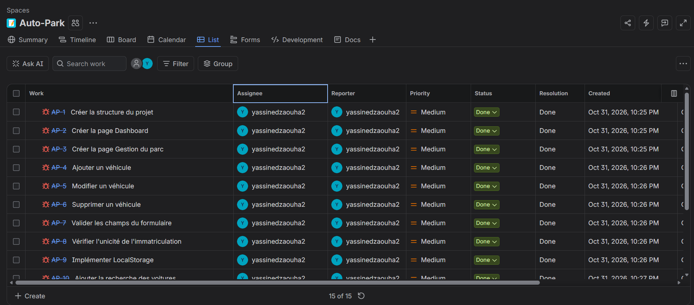
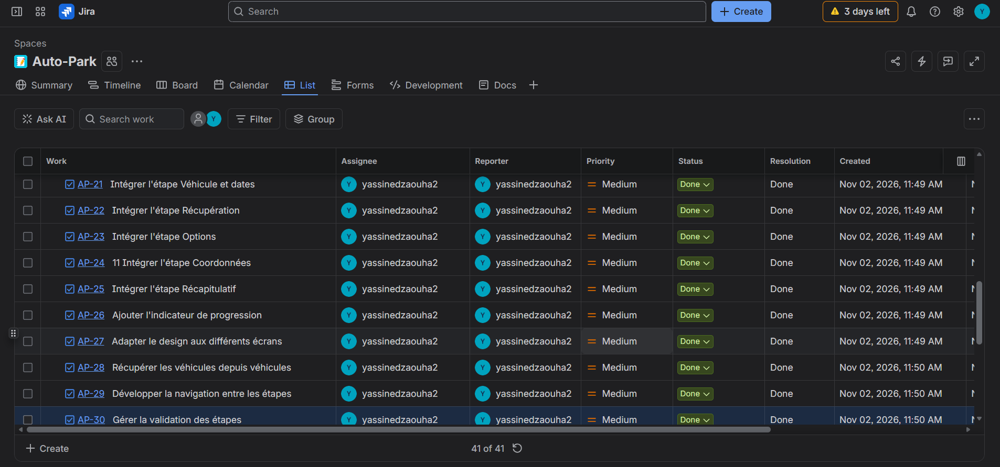

# AutoPark — Application de gestion automobile
 
## Présentation du projet
 
**AutoPark** est une application web de gestion de parc automobile développée dans le cadre d'un projet individuel chez YouCode.
 
L'application permet à une agence fictive de location de voitures, Atlas Auto, de gérer facilement son parc automobile : consulter les véhicules, ajouter de nouvelles voitures, modifier leurs informations et suivre leur disponibilité. Elle permet aussi de composer une location en quelques étapes, avec un calcul du prix en temps réel.
 
Le projet est composé de trois interfaces principales :
 
- **Dashboard :** affiche les statistiques du parc automobile.
- **Gestion du parc :** permet de gérer les véhicules et leurs informations.
- **Ma Location :** permet de composer une location (véhicule, dates, récupération, options) et d'en vérifier le récapitulatif.
## Démo en ligne
 
[Accéder à l'application AutoPark](https://yassine-dzaouha.github.io/Auto-Park/index.html)
 
## Aperçu du projet
 


 
## Fonctionnalités
 
### 1. Gestion des véhicules
 
- Afficher dynamiquement la liste des voitures.
- Ajouter un nouveau véhicule.
- Modifier les informations d'un véhicule.
- Supprimer un véhicule avec confirmation.
- Valider les champs du formulaire.
- Vérifier l'unicité de l'immatriculation.
### 2. Recherche et organisation
 
- Rechercher une voiture par marque, modèle ou immatriculation.
- Filtrer les véhicules par catégorie et par statut.
- Trier les voitures selon leur prix journalier.
- Réinitialiser les critères de recherche et de filtrage.
### 3. Dashboard
 
- Afficher le nombre total de véhicules.
- Afficher le nombre de voitures disponibles.
- Afficher le nombre de voitures louées.
- Afficher le nombre de voitures en maintenance.
### 4. Composez votre location
 
Un parcours en **4 étapes**, avec une barre de progression (les étapes terminées affichent ✓) et un panier récapitulatif toujours visible à droite.
 
**Étape 1 — Véhicule et dates**
 
- Afficher dynamiquement les voitures depuis les données du parc, avec leur catégorie, leur statut et leur prix par jour.
- Sélectionner une voiture : ses détails apparaissent immédiatement dans le panier.
- Choisir les dates de début et de fin, avec affichage de la durée (les deux dates sont incluses : du 10 au 12 = 3 jours).
- Validation : véhicule choisi, dates renseignées, début non passé, fin cohérente avec le début.
- Bouton **Recommencer** pour revenir aux valeurs initiales.
**Étape 2 — Récupération**
 
- Trois modes de récupération générés depuis la configuration :
  - À l'agence (gratuit) : heure de récupération.
  - À l'aéroport (+150 MAD) : aéroport, numéro de vol, heure d'arrivée.
  - À une adresse (+100 MAD) : ville, adresse complète, heure de livraison.
- Affichage du formulaire du mode sélectionné uniquement, les autres sont masqués.
- Validation des champs du mode choisi avant de continuer.
- Les frais de récupération sont ajoutés une seule fois au total.
**Étape 3 — Options**
 
- Options facultatives facturées par jour, générées depuis la configuration :
  - Siège bébé (30 MAD / jour).
  - Conducteur supplémentaire (200 MAD / jour).
- Pour chaque option : prix par jour et prix total pour la durée choisie.
- Les options cochées apparaissent dans le panier.
**Étape 4 — Récapitulatif**
 
- Vérification de la demande : véhicule et dates, récupération, options.
- Seuls les champs concernés par le mode de récupération choisi sont affichés.
- Boutons **Modifier** pour revenir à l'étape concernée.
- Bouton **Confirmer** : la demande est simulée, aucun paiement n'est demandé.
**Panier et calcul du prix**
 
- Le panier se met à jour à chaque choix : voiture, dates, durée, options, récupération et total estimé.
- Aucun total numérique n'est affiché tant que la voiture ou les dates sont manquantes ou invalides.
- Formule du prix :
```text
Total = jours × (prix par jour de la voiture + options par jour) + frais de récupération
```
 
- Exemple de contrôle : Sandero, du 10 au 12, siège bébé, aéroport → 3 × (250 + 30) + 150 = **990 MAD**.
**Navigation entre les étapes**
 
- Une seule étape est affichée à la fois.
- Le bouton **Suivant** valide l'étape courante avant de passer à la suivante.
- Le bouton **Précédent** permet de revenir en arrière sans perdre les choix.
- Les choix de l'utilisateur sont conservés dans un objet unique (`selectedConfig`).
### 5. Sauvegarde des données
 
- Utilisation de `localStorage` pour conserver les données.
- Récupération des données après le rechargement de la page.
- Partage des mêmes données entre le Dashboard, la page Gestion du parc et la page Ma Location.
## Technologies utilisées
 
- HTML5
- CSS3
- Tailwind CSS
- JavaScript Vanilla (ES6+)
- DOM Manipulation (création des éléments avec `createElement`)
- ES6 Modules (Import / Export)
- LocalStorage
- Git et GitHub
- Jira
## Organisation du projet
 
```text
Auto-Park/
│
├── index.html
├── voitures.html
├── location.html
│
├── css/
│   └── style.css
│
├── js/
│   ├── data.js
│   ├── voitures.js
│   ├── location.js
│   └── dashBorad.js
│
├── assets/
```
 
## Concepts JavaScript appliqués dans la page Location
 
- Objet de configuration (`config`) : voitures, modes de récupération, options et leurs tarifs.
- Objet de sélection (`selectedConfig`) : étape courante, voiture, dates, mode de récupération, informations de récupération et options.
- Génération dynamique des cartes (voitures, modes de récupération, options) avec une fonction `createElement`.
- Une fonction de validation par étape, appelée avant de passer à la suivante.
- Une fonction de navigation unique pour afficher l'étape choisie et mettre à jour la barre de progression.
- Calcul des dates incluses, du prix des options et du total en temps réel.
 
