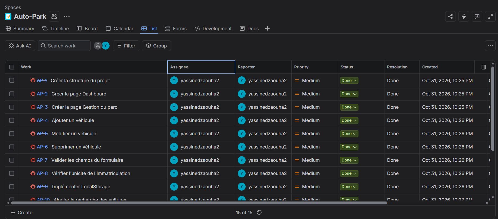

# AutoPark — Application de gestion automobile

## Présentation du projet

**AutoPark** est une application web de gestion de parc automobile développée dans le cadre d'un projet individuel chez YouCode.

L'application permet à une agence fictive de location de voitures, Atlas Auto, de gérer facilement son parc automobile : consulter les véhicules, ajouter de nouvelles voitures, modifier leurs informations et suivre leur disponibilité.

Le projet est composé de deux interfaces principales :

- **Dashboard :** affiche les statistiques du parc automobile.
- **Gestion du parc :** permet de gérer les véhicules et leurs informations.

## Démo en ligne

[Accéder à l'application AutoPark](https://yassine-dzaouha.github.io/Auto-Park/index.html)

## Aperçu du projet



## Fonctionnalités

### 1. Gestion des véhicules

- Afficher dynamiquement la liste des voitures.
- Ajouter un nouveau véhicule.
- Modifier les informations d'un véhicule.
- Supprimer un véhicule avec confirmation.
- Valider les champs du formulaire.
- Vérifier l'unicité de l'immatriculation.

### 2. Recherche et organisation

- Rechercher une voiture par marque, modèle ou immatriculation.
- Filtrer les véhicules par catégorie et par statut.
- Trier les voitures selon leur prix journalier.
- Réinitialiser les critères de recherche et de filtrage.

### 3. Dashboard

- Afficher le nombre total de véhicules.
- Afficher le nombre de voitures disponibles.
- Afficher le nombre de voitures louées.
- Afficher le nombre de voitures en maintenance.

### 4. Sauvegarde des données

- Utilisation de `localStorage` pour conserver les données.
- Récupération des données après le rechargement de la page.
- Partage des mêmes données entre le Dashboard et la page Gestion du parc.

## Technologies utilisées

- HTML5
- CSS3
- JavaScript Vanilla (ES6+)
- DOM Manipulation
- ES6 Modules (Import / Export)
- LocalStorage
- Git et GitHub
- Jira

## Organisation du projet

```text
Auto-Park/
│
├── index.html
├── voitures.html
│
├── css/
│   └── style.css
│
├── js/
│   ├── data.js
│   ├── voitures.js
│   └── ...
│
├── assets/
│   └── kanban-autopark.png
│
└── README.md